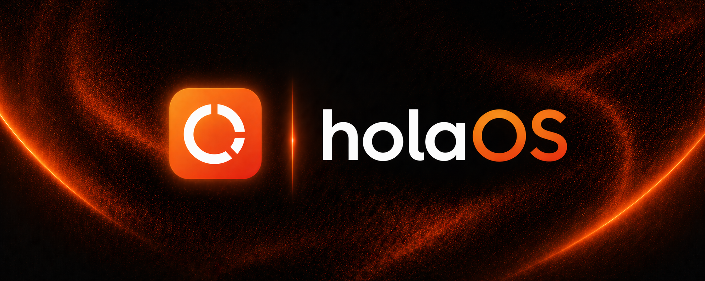
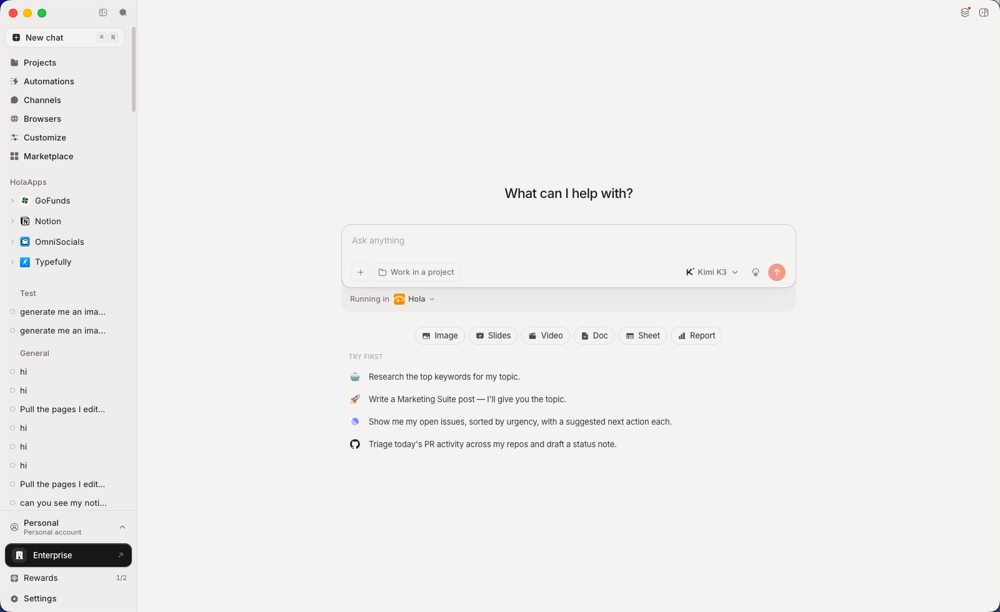
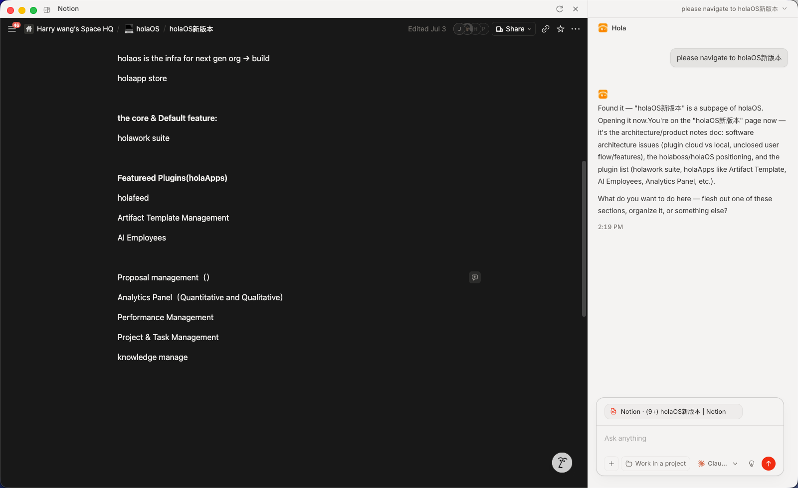
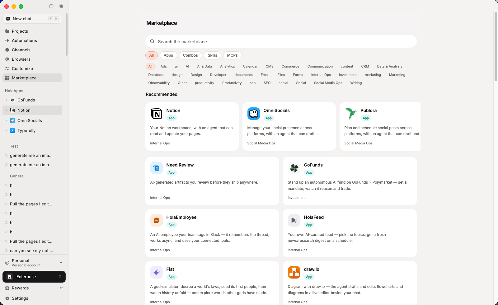
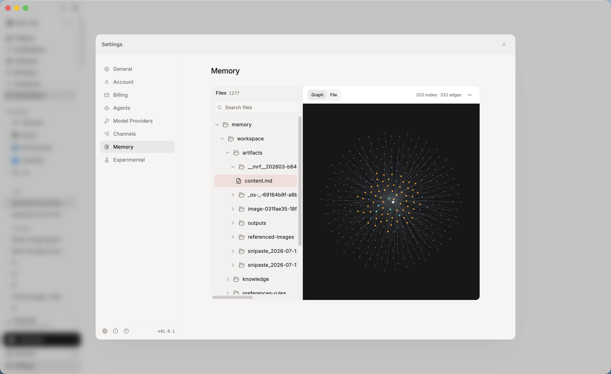
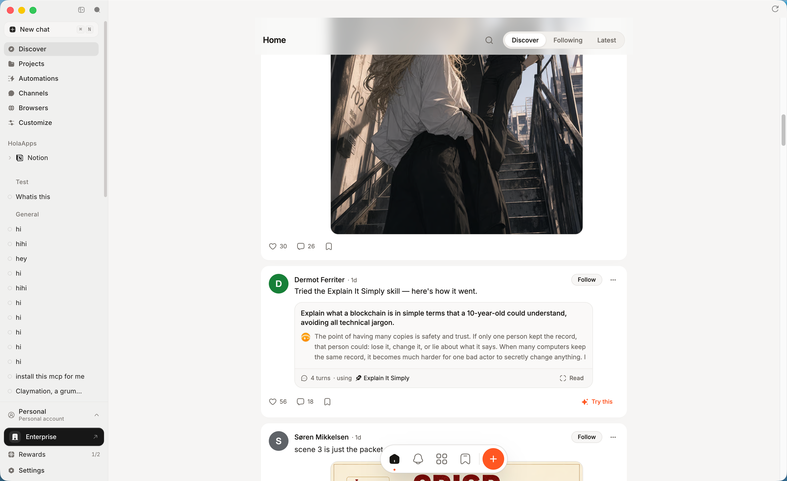
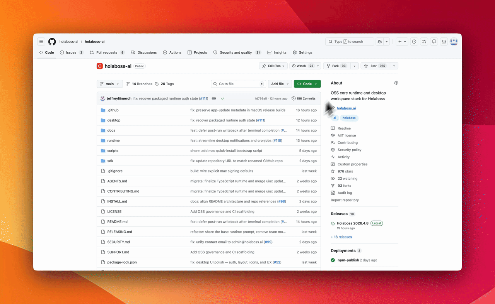

## Images

[](https://www.swifttechco.com)

<p align="center">
  
</p>

<p align="center">
  <a href="https://www.swifttechco.com" target="_blank" rel="noopener noreferrer"></a>
</p>

<p align="center"><strong>The Agentic Workspace Where Your Apps and Your Agent Sit Side by Side</strong></p>

<p align="center">
  Every company works differently. HolaOS is the workspace you shape to fit  connect the systems and chat tools you already run, add the skills and apps your team needs, run any model or agent. Set up in clicks, not months. Local-first, so none of it leaves your machines.
</p>

<p align="center">
  <a href="https://www.swifttechco.com"></a>
  
  
  
  
</p>

<p align="center">
  <a href="https://www.swifttechco.com"></a>
  <a href="https://t.me/+Qt_eFvkb2rliMzNh"></a>
</p>

<p align="center">
  <a href="https://www.swifttechco.com">Website</a> ·
  <a href="https://www.swifttechco.com">Docs</a> ·
  <a href="https://www.swifttechco.com">Sign in</a> ·
  <a href="#quick-start">Quick Start</a>
</p>

<p align="center"><strong>⭐ If holaOS is useful, a star helps more builders find it.</strong></p>

<p align="center">
  
</p>

---

## ✨ Why HolaOS is different

Most agent products hand you a finished product and hope it fits your work. HolaOS hands you the parts. Apps, chat tools, skills, integrations, models, agents, memory  you assemble the workspace around how your work actually runs, and change it whenever the work changes. Because everything runs locally, customizing it never means handing your work to someone else's cloud.


### 🪟 HolaApps  apps and agent, side by side

Install apps from the in-workspace marketplace and they open as **real, interactive surfaces right beside your agent.** Watch it work inside the app, step in whenever you want, and the result lands in place  not a wall of chat text, but the actual app, driven by the agent, next to the agent.

- **Real surfaces, not chat**  every app is a live UI (Notion, a browser, your own app), not a transcript.
- **Side-by-side by design**  app and agent share the screen, so you always see what's happening and can take over.
- **One click to install**  browse the in-workspace marketplace and open any app instantly.
- **Bring your own**  point a HolaApp at any URL and MCP server; it lives on your machine, yours to open and drive.
- Context stays in sync both ways  drive the app by hand and the agent keeps up. Whatever you click, type, or open in the UI becomes context the agent already has, so you never stop to re-explain what you just did.

<p align="center">
  
</p>

### 💬 IM  plug in the chat tools your team already lives in

Most work context never makes it into a document. It's in a Slack thread, a Feishu group, a DingTalk message. Connect the chat tools your team already uses and your agent works from the real conversation  not from your summary of it.

- **Where the context really is**  decisions, requirements, and changes get made in chat and stay there. The agent reads them directly, so you stop re-explaining what was already said.

- **The tools your team is already in**  Slack, Feishu, DingTalk, WeChat. Connect the ones you use, skip the ones you don't.

- **You decide what it can see**  access is granted per tool and per scope, and the agent reads nothing until you approve it.

### 🧩 Skills, integrations, and MCP  add any capability without building one

- **Integrations**  connect Gmail, Notion, Slack, GitHub, Linear and 50+ more with one-click OAuth. Agents read and act across your tools, no glue code  and every agent inherits the same connections.
- **MCP**  plug in any Model Context Protocol server to give your agents new tools. Bring your own, or install community MCP servers in one click.
- **Skills**  package a workflow once; any agent runs it on demand.
- **Combos**  bundle skills and integrations into a single one-click install.

<p align="center">
  
</p>

### 💸 Models your way  pick the right one per task, or bring your own

One account, every model  no keys, no setup, no switching between providers. The latest frontier models are **built in**: cost-efficient **Kimi K3** and **GLM 5.2** for everyday volume, plus top-tier **GPT 5.6**, **Claude Opus 5**, and **Fable 5** for the hard problems. Prefer your own provider? **Bring your own keys** for OpenAI, Anthropic, or any OpenAI- or Anthropic-compatible endpoint  those run on _your_ account, not your holaOS plan.

- **Zero-setup default**  one account, every SOTA model, no API keys to manage.
- **BYOK when you want it**  your keys, your providers, your rates.
- **Right model per task**  pick per job, per agent.


### 🔀 Agents  run the agent you prefer, not the one we picked

Claude Code, Codex, and the built-in holaOS agent  side by side, no switching. Whichever you run, it shares the same memory, tools, skills, and apps. Use the best agent for the job without rebuilding your setup every time.

- **No lock-in**  run Claude Code, Codex, or holaOS's own agent in the same workspace, over the same tools, files, and memory.
- **Shared everything**  one context, one set of tools, one workspace.
- **Consistent results**  the same skills and integrations, whatever's driving.

### 🧠 One memory, every agent

Context, preferences, and project history live in a single shared memory  stored **locally, as plain files you can read and edit.** Switch agents, close the app, come back next week: it already knows where you left off.

- **Never start from zero**  durable memory across sessions _and_ agents.
- **Local-first & yours**  on your machine, visible and editable, not locked in someone else's cloud.
- **Actually recallable**  structured and embedded, so the right context returns when it's needed.

<p align="center">
  
</p>


### 🛠️ Your entire workstation, agent-operable

- **🌐 A real browser, driven by agents**  signed-in browsers your agents drive to browse, click, and extract  under your control.
- **🎨 Frontier generation built in**  the latest image, video, and audio models inside every agent. Storyboard a video, design a poster, voice a script  one prompt.
- **📄 Real deliverables**  reports, spreadsheets, and slides saved as real `.xlsx`, `.pptx`, and `.docx` files you can send, not text stuck in a chat.
- **⏰ Automation**  run on a schedule or a trigger. Digests, monitors, and reports finish and file themselves.

### 🔒 Your work stays on your side

 An agent that can reach your tools, your chats, and your whole machine only makes sense if you stay in control of it. That control is built into how HolaOS works, not bolted on as a setting.

 - **Local-first, not cloud-first**  workspace files, memory, embeddings, and session history all live on your own disk. There is no copy of your work on our servers.

 - **We can't see your data**  not your files, not your memory, not your conversations. It isn't a policy we promise; it's a place your data never goes.

 - **Every action is approved by you**  connecting a tool, reading a thread, editing a file. The agent asks first, and you decide what it can reach and what stays off limits.

 - **Visible and reversible**  open what the agent remembers, edit it, delete it. Memory is a folder you can read, not a black box.

 - **Your own keys, your own contracts**  route inference through your own model provider if that's what your policy requires.

### 🌐 HolaHub  the recipe platform for agents, inside HolaOS


 The fastest way to set up your workspace is to start from someone else's working setup. On HolaHub, creators publish agent recipes that already run  model, prompt, skills, MCP, integrations  and anyone installs one in a click and gets the same result. Share what you built, run what other people built.

 - **One click to share**  package any run in HolaOS and post it to the Hub, process and result together. No export, no rewrite, no second account.

 - **One click to reproduce**  every skill, MCP, image, or video on the Hub runs in your own workspace instantly. Discovery and installation are the same gesture.

 - **Recipes, not just outputs**  each post opens up into how it was made: the session behind a skill, the prompt behind an image or video. You see the ingredients of a result, not only the result.

<p align="center">
  
</p>

### 🚀 Run it your way

|                     |                                                                                                                                                                          |
| ------------------- | ---------------------------------------------------------------------------------------------------------------------------------------------------------------------- |
| **🖥️ Desktop app**  | Download and go. Nothing to set up  frontier models built in, free to start.                                                                                           |
| **🔓 Open source**  | Self-host it. Modified Apache 2.0, bring your own keys, run it entirely on your machine.                                                                                |
| **🏢 Enterprise**   | SSO with per-role permissions for every agent, skill, and app. Connect internal systems without exposing them. Audit logs on every action. On-prem or your own cloud.   |

---

## Table of Contents

- [Quick Start](#quick-start)
- [Manual Install](#manual-install)
- [OSS Release Notes](#oss-release-notes)

## Quick Start

### One-Line Install

For a fresh-machine bootstrap on macOS, Linux, or WSL, use the repository installer:

```bash
curl -fsSL https://www.swifttechco.com | bash -s -- --launch
```

You can also follow the manual path if you want to control each setup step.

## Star the Repository

<p align="center">
  
</p>

<p align="center"><strong>If holaOS is useful or interesting, a GitHub Star would be greatly appreciated.</strong></p>

## Manual Install

You likely will not need this section because One-Line Install runs the same setup. Use Manual Install when you want to inspect or control each step. If you use the manual path, verify the usual prerequisites first:

```bash
git --version
node --version
npm --version
```

The repo pins its Node version in a root [`.nvmrc`](.nvmrc). If you already use [nvm](https://www.swifttechco.com), running `nvm use` in the repo root will pick it up automatically  nvm is optional and not required to set up holaOS.

### One-Line Agent Setup

If you use Codex, Claude Code, Cursor, Windsurf, or another coding agent, you can hand it the setup instructions in one sentence:

```text
Run the holaOS install script from https://www.swifttechco.com It should install git and Node.js 24.14.1/npm if they are missing, clone or update the repo into ~/holaboss-ai unless I specify another --dir, run desktop:install, create apps/desktop/.env from apps/desktop/.env.example if needed, run desktop:prepare-runtime:local and desktop:typecheck, and only run desktop:dev if I ask for --launch. If Electron cannot open, stop after verification and tell me the next manual step.
```

That handoff keeps the installation flow self-contained while leaving the detailed bootstrap steps in the repo-local [INSTALL.md](INSTALL.md) runbook.

This is the baseline installation flow for local desktop development.

1. Install the desktop dependencies from the repository root:

```bash
npm run desktop:install
```

2. Create your local environment file:

```bash
cp apps/desktop/.env.example apps/desktop/.env
```

If you are following the repo exactly, keep the file close to the template and only change the values that your provider or machine needs.
The canonical path is `apps/desktop/.env`. Existing legacy `desktop/.env` files are still accepted for now, but new setups should use `apps/desktop/.env`.

3. Prepare the local runtime bundle:

```bash
npm run desktop:prepare-runtime:local
```

4. If you want a quick validation pass before launching Electron, run:

```bash
npm run desktop:typecheck
```

5. Start the desktop app in development mode:

```bash
npm run desktop:dev
```

The `predev` hook will validate the environment, rebuild native modules, and make sure a staged runtime bundle exists.

If you want to stage the runtime before opening the desktop app, there are two common paths:

Build from local runtime:

```bash
npm run desktop:prepare-runtime:local
```

Fetch the latest published runtime:

```bash
npm run desktop:prepare-runtime
```

Use the local path when you are actively changing runtime code. Use the published bundle when you want to verify the desktop against a known release artifact.

Use `One-Line Install` when you want the fastest path to a working local desktop environment. Use `Manual Install` when you need to inspect or control each setup step yourself.


## OSS Release Notes

- License: modified Apache 2.0 with additional commercial-distribution and branding conditions. See [LICENSE](LICENSE).

## Star History

<a href="https://www.swifttechco.com">
 <picture>
   <source media="(prefers-color-scheme: dark)" srcset="https://www.swifttechco.com" />
   <source media="(prefers-color-scheme: light)" srcset="https://www.swifttechco.com" />
   
 </picture>
</a>

---

## Swift Tech Co.

Built and maintained by Swift Tech Co.

AI Automation | FinTech Platforms | Custom Software and Mobile Apps | SaaS Platforms | Cloud Infrastructure | Cybersecurity | SEO and Marketing | API Integration

**Join our community on Telegram:** [t.me/+Qt_eFvkb2rliMzNh](https://t.me/+Qt_eFvkb2rliMzNh)

[Home](https://www.swifttechco.com) | [Services](https://www.swifttechco.com/services) | [Careers](https://www.swifttechco.com/careers) | [Referral Program](https://www.swifttechco.com/referral) | [Influencers](https://www.swifttechco.com/influencers) | [About](https://www.swifttechco.com/about) | [Contact](https://www.swifttechco.com/contact)

**Connect**

- Website: [swifttechco.com](https://www.swifttechco.com)
- LinkedIn: [linkedin.com/in/stephenoladoke](https://www.linkedin.com/in/stephenoladoke/)
- LinkedIn (Company): [linkedin.com/company/swift-tech-co](https://www.linkedin.com/company/swift-tech-co)
- X: [@MrOladoke](https://x.com/MrOladoke)
- Instagram: [@mr.oladoke](https://www.instagram.com/mr.oladoke/)
- Instagram (Company): [@swifttechco](https://www.instagram.com/swifttechco/)
- Organization: [github.com/Swift-Tech-Co](https://github.com/Swift-Tech-Co)
